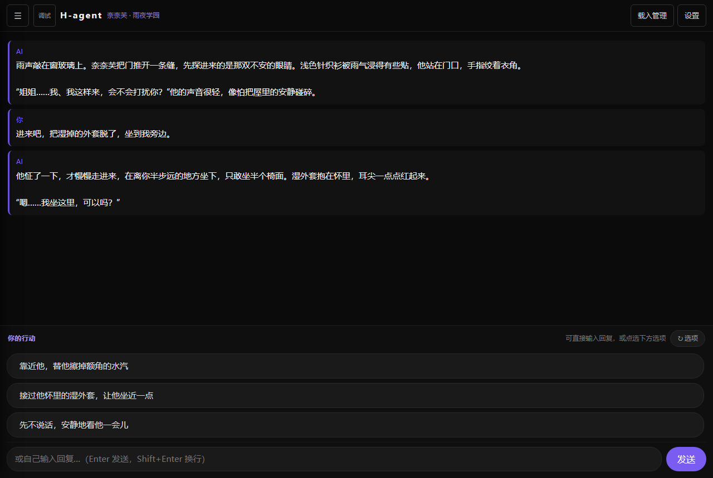

# H-agent

> 单文件网页版 AI 角色扮演 / 互动小说前端，在原项目 [H-agent](https://xiyinnnnnn.github.io/H-agent/) 基础上二次开发。


> [!WARNING]
> **本应用面向成人向角色扮演场景，生成内容可能包含性相关内容，仅限 18 岁及以上成年人使用。** 请确保你导入的角色卡与素材均为虚构、且所有角色均为成年人；内容不代表任何现实人物或事件。请遵守你所在地区的法律法规以及所用模型服务商的使用条款。



---

## 目录

- [项目简介](#项目简介)
- [本次改进](#本次改进)
- [功能特性](#功能特性)
- [快速开始](#快速开始)
- [使用说明](#使用说明)
- [数据与隐私](#数据与隐私)
- [部署到 GitHub Pages](#部署到-github-pages)
- [文件结构](#文件结构)
- [常见问题](#常见问题)
- [致谢](#致谢)
- [免责声明](#免责声明)
- [许可证](#许可证)

---

## 项目简介

H-agent 是一个**纯前端、零构建、单文件**的 AI 角色扮演工具。整个应用就是一个 `index.html`，不需要 Node.js、不需要安装依赖、不需要后端服务，双击打开即可使用。

它把「角色卡 + 世界书 + 大纲 + 多轮对话」组织成可持续推进的互动故事：每轮 AI 叙述结束后，你可以点选系统生成的行动选项，也可以完全自由地输入自己的回复。

本项目基于 **Xiyinnnnnn** 的 [H-agent](https://xiyinnnnnn.github.io/H-agent/) 改进而来，感谢原作者的开源与探索。

## 本次改进

相对原版，本仓库主要做了以下改动：

- **每轮回复面板**
  - AI 叙述结束后，可点选生成的行动选项，也可直接在输入框自由回复
  - Enter 发送、Shift+Enter 换行，兼容中文输入法（选词回车不会误发）
  - 输入框自动增高；生成期间面板统一禁用，避免重复提交
  - 支持一键「↻ 选项」重新生成当前这轮的选项
- **多会话管理**
  - 左侧边栏可随时删除任意会话；删除正在生成的当前会话会先中断请求
  - 会话标题由「角色卡名称 + 世界观 / 世界书名称」自动构成，例如 `奈奈芙 · 雨夜学园`
  - 支持手动重命名；老数据启动时自动迁移标题
  - 触屏设备上重命名 / 删除按钮始终可见
- **本地记忆（持久化）**
  - 会话、剧情历史、大纲、选项、角色卡、世界书等自动保存到浏览器 `localStorage`
  - 关闭页面、切到后台、手机杀进程前会自动兜底保存
  - 存储空间不足时明确提示，并建议导出备份
  - 同一设备、同一地址重新打开即可恢复上次进度
- **稳定性**
  - 请求失败或取消后自动清理空消息占位，避免污染下一轮上下文
  - 生成中删除会话不会把残留数据写进其他会话
- **数据**
  - 本仓库不附带角色卡 / 世界书数据，请自行准备并导入合法、角色均为成年人的素材

## 功能特性

- 🎭 **角色卡系统**：支持 SillyTavern V2 角色卡、Character.AI 定义、Chub/Venus、RisuAI、NovelAI Lorebook 等格式的导入与转换
- 📚 **世界书**：关键词触发、优先级、常驻条目，按场景自动注入上下文
- 🧭 **剧情大纲**：自动生成故事大纲与节拍，按节奏推进
- 💬 **双通道回复**：生成选项 + 自由输入，兼顾沉浸感与自由度
- 🗂️ **多会话**：每个会话拥有独立的剧情、大纲、选项与历史；角色卡、世界书、API 设置全局共享
- 🧠 **上下文管理**：累计 Token 达到阈值后自动压缩早期历史为摘要，保留最近剧情原文
- 🎨 **叙事偏好**：故事方式、长度、场景、玩法、节奏、高潮要求等可调
- 🔌 **自定义模型**：兼容 OpenAI 格式 `/chat/completions` 的接口，默认针对 DeepSeek 模型配置
- 📦 **导入 / 导出**：可导出全部数据或部分数据，便于备份与迁移
- 💾 **本地优先**：全部数据留在本机浏览器，不经过任何中间服务器

## 快速开始

### 方式一：直接使用

1. 下载或克隆本仓库
2. 用现代浏览器（Chrome / Edge / Firefox / Safari）打开 `index.html`
3. 按提示填写 API 配置
4. 进入「载入管理」，导入并选择你自己的角色卡与世界书，点击「导入选中并开始游戏」

> 也可以直接访问 GitHub Pages 在线版（见[部署到 GitHub Pages](#部署到-github-pages)）。

### 方式二：本地静态服务（推荐）

部分浏览器对 `file://` 下的存储与跨域有限制，推荐起一个本地静态服务：

```bash
# 任选一种
python3 -m http.server 8080
# 或
npx serve .
```

然后访问 <http://localhost:8080>。

### API 配置

在「设置 → API」中填写：

| 配置项 | 说明 | 默认值 |
| --- | --- | --- |
| Base URL | OpenAI 兼容接口地址 | `https://api.deepseek.com` |
| API Key | 你的密钥 | 空 |
| 模型 | 模型名称，可自行添加 | `deepseek-v4-flash` |
| 思考强度 | off / high / max | high |
| MaxToken | 单次上下文上限 | 384000 |

默认配置面向 DeepSeek；其他兼容 `/chat/completions` 的服务通常也可以使用，但工具调用（`tools`）支持不完整时可能影响角色记忆注入效果。
API Key 只保存在你自己浏览器的 `localStorage` 中，不会上传到本项目或第三方。

### 准备角色卡

本仓库**不附带任何角色卡或世界书数据**。请使用你拥有合法授权、且所有角色均为成年人的素材，或使用压缩包里已生成的角色卡（default.json）：

1. 打开「设置」→「导出 / 导入」→「导入」，选择你的角色卡 / 世界书 JSON
2. 也可以在「载入管理 → 转换」中粘贴第三方格式文本进行转换
3. 确认导入后，进入「载入管理」勾选角色卡与世界书，点击「导入选中并开始游戏」

> 请勿导入或传播涉及未成年人的性内容，以及未经授权的第三方素材。

## 使用说明

- **开始对话**：载入角色卡后点击「开始这段对话」，应用会先生成大纲，再生成开场剧情
- **每轮行动**：
  - 点选下方生成好的行动选项
  - 或在输入框输入任意回复（Enter 发送，Shift+Enter 换行）
  - 选项不满意时点「↻ 选项」重新生成
- **多会话**：左上角 ☰ 打开对话列表，可新建、切换、重命名、删除任意会话
- **会话命名**：未手动命名的会话会自动使用「角色卡 + 世界观」作为标题
- **备份**：建议定期在「设置 → 导出」中导出数据；换浏览器、换路径、清理站点数据都会导致本地存档不可用

## 数据与隐私

- 所有数据保存在浏览器 `localStorage`（存储键：`sesedrive_pro_v5`），不上传任何服务器
- 对话请求由浏览器直接发送到你配置的模型 API 地址
- 关闭页面、切后台时会自动保存；同一设备、同一访问地址重新打开即可恢复
- 以下情况会导致数据不可恢复：清理浏览器站点数据、更换浏览器 / 无痕模式、更换访问地址（`file://` 路径或域名 / 端口不同）、存储空间不足
- `localStorage` 容量通常约 5MB；角色卡与历史很多时请留意提示，并及时导出备份
- 请勿在公共电脑上保存 API Key 或私密剧情

## 部署到 GitHub Pages

本仓库无需构建，直接部署静态文件即可：

1. 在 GitHub 新建仓库（例如 `H-agent`），将本仓库文件推送到 `main` 分支
2. 打开仓库 **Settings → Pages**
3. **Build and deployment → Source** 选择 `Deploy from a branch`
4. 分支选择 `main`，目录选择 `/ (root)`，保存
5. 稍等片刻，访问 `https://<你的用户名>.github.io/H-agent/`

本仓库已包含 `.nojekyll`，可避免 Jekyll 处理静态文件。

## 文件结构

```text
H-agent/
├── index.html                  # 全部应用逻辑与样式（单文件）
├── docs/
│   ├── screenshot.png          # 主界面截图
│   └── screenshot-sidebar.png  # 多会话侧边栏截图
├── README.md
├── CHANGELOG.md
├── CONTRIBUTING.md
├── LICENSE
├── .gitignore
└── .nojekyll
```

## 常见问题

**打开后提示「请先配置 API」？**
首次使用需要在设置中填写 Base URL 与 API Key，然后点击「测试连接」。

**会话/剧情会不会丢？**
同一设备、同一地址下会自动保存在浏览器本地。换浏览器、清理站点数据、换访问地址都会丢失，请定期导出备份。

**关闭页面时正在生成，会保存吗？**
已生成并写入历史的内容会在完成或离开页面时保存；正在流式输出中的最后一段可能不完整。

**提示「本地存储空间不足」？**
删除部分旧会话，或先导出备份后清理站点数据。角色卡与世界书也占用空间。

**选项生成失败或没有选项？**
应用会重试并使用兜底选项；也可以直接自己在输入框回复。

**可以用其他模型吗？**
可以，填写兼容 OpenAI `/chat/completions` 的 Base URL 与模型名即可；不同服务对 `thinking`、工具调用等扩展参数支持不同，必要时请自行调整。

**手机上怎么用？**
直接用手机浏览器打开部署好的网页即可；界面已适配移动端。

## 致谢

- 感谢 **[Xiyinnnnnn](https://github.com/Xiyinnnnnn)** 创建并开源原项目 **[H-agent](https://xiyinnnnnn.github.io/H-agent/)**。本项目的界面结构、角色卡体系、世界书与提示词框架均源自原项目；没有原作者的探索，就不会有这个改进版。
- 感谢原项目及其贡献者对 AI 角色扮演前端体验的探索。
- 感谢所有测试反馈者。
- 感谢 DeepSeek 等模型服务商提供可用的 API。

> 原项目地址可能随时间变更；若上方链接失效，可在 GitHub 搜索作者 `Xiyinnnnnn`。

## 免责声明

1. 本项目仅供**成年人**学习、研究与个人娱乐使用，**严禁未成年人使用**。
2. 所有角色、剧情均为虚构；如涉及现实人物、团体或事件，纯属巧合。
3. AI 生成内容不代表本项目作者的观点；使用者需自行判断内容的准确性与合法性。
4. 本仓库不附带角色卡 / 世界书数据。使用者应自行确保所用素材拥有合法授权，且**所有角色均为成年人**；不得导入或传播涉及未成年人的性内容。
5. 本项目不提供任何明示或暗示的担保；因使用本项目造成的任何直接或间接损失，作者不承担责任。
6. 请遵守你所在地区的法律法规及所使用模型服务商的使用条款；请勿将本项目用于违法、有害或侵害他人权益的用途。
7. 如权利人认为本仓库内容侵犯其权益，请联系删除。

## 许可证

本项目采用 [MIT License](LICENSE) 发布。

- 原项目 **H-agent** 版权归 **Xiyinnnnnn** 所有
- 本仓库中的修改与新增部分版权归 **vesper-Ye** 所有
- 如原项目另有独立的许可证或使用条款，以原项目声明为准

---

如果这个项目对你有帮助，欢迎点一个 ⭐ Star；有问题或建议可以提交 Issue。
